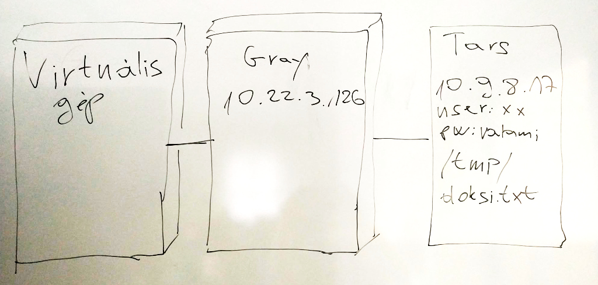

# Próba ZH

## Számolási feladat

Melyik IP címmel rendelkező számítógépek tudnak egymással közvetlenül
kommunikálni?

| IP cím | Alhálózati maszk |
| ------ | ---------------- |
| 192.168.6.17  | 255.255.255.224 |
| 192.168.6.35  | 255.255.255.224 |
| 192.168.6.98  | 255.255.255.224 |
| 192.168.6.80  | 255.255.255.224 |
| 192.168.6.41  | 255.255.255.224 |
| 192.168.6.231 | 255.255.255.224 |
| 192.168.6.14  | 255.255.255.224 |
| 192.168.6.30  | 255.255.255.224 |
| 192.168.6.199 | 255.255.255.224 |
| 192.168.6.84  | 255.255.255.224 |

Mi a helyzet akkor, ha a az alhálózati maszk minden esetben 255.255.255.128?

## Linux gyakorlat

Adott a következő képen látható, 3 számítógépből álló hálózat.
A feladat: szerezzük meg a Tars nevű gépről a /tmp/doksi.txt
nevű fájl md5 hash-ét.

